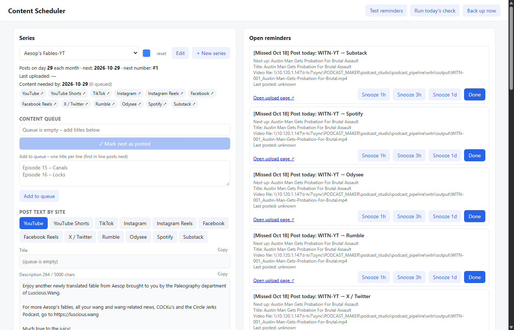

# Podcast Studio

Two Python apps that work together:

- **`podcast_studio/podcast_pipeline/`** — turns script text into finished podcast episodes: local-LLM title + image prompts, TTS narration (Google / Piper / Kokoro), and ffmpeg video (intro → middle → outro, plus a vertical TikTok export). Each series is its own process (`witn`, `aesop`, `cocku`, `confuscius`, `audio`).
- **`podcast_studio/content_scheduler/`** — Flask + system-tray app. Holds a queue per series, works out posting dates, sends reminders, and auto-posts where an API allows (YouTube / YouTube Shorts). Finished video episodes are handed off from the pipeline via `common/schedule_handoff.py` into `content_scheduler/inbox/`.

## Layout

```
PODCAST_MAKER/
├── memory.md, CLAUDE.md        # project notes / agent guidance
├── podcast_studio/
│   ├── podcast_pipeline/
│   │   ├── common/             # shared code (edit here, not in copies)
│   │   │   ├── utils.py        # config, naming, LLM (Ollama/LM Studio), TTS, ffmpeg
│   │   │   ├── steps.py        # setup() + argparse, image-prompt prep, image pause
│   │   │   ├── image_flow.py   # WITN + Aesop engine
│   │   │   ├── rewrite.py      # WITN rewrite of script-in.txt, per-story .txt, Word file
│   │   │   ├── progress.py     # per-story resume (progress.json)
│   │   │   └── schedule_handoff.py
│   │   ├── witn/ aesop/ cocku/ confuscius/ audio/
│   │   │   └── <name>.py, config.json, assets/, sequence.json, progress.json, output/
│   │   └── tools/list_voices.py
│   └── content_scheduler/
│       ├── app.py              # all server logic
│       ├── templates/index.html # whole GUI
│       ├── config.yaml         # sites, series, reminders
│       ├── series.yaml         # optional; REPLACES the series list in config.yaml
│       ├── tray.py, secrets.example.yaml
│       └── service/            # OS service installers
└── social-scheduler/           # legacy/optional platform-focused scheduler (not wired to the pipeline)
```

## Requirements

- Python 3.14 (Windows-focused; Linux/macOS installers also provided for the scheduler service)
- `ffmpeg` on PATH
- For LLM: Ollama (`localhost:11434`) or LM Studio (`llm.backend: lmstudio`, port 1234)
- For TTS: Google (network), Piper (`C:/piper/piper.exe`), or Kokoro (server or `kokoro-onnx`)
- See `podcast_studio/podcast_pipeline/requirements.txt` and `podcast_studio/content_scheduler/requirements.txt`

## Quick start

Pipeline (run from a process folder or pass paths):

```bash
python podcast_studio/podcast_pipeline/witn/witn.py            # rewrites script-in.txt, then builds
python podcast_studio/podcast_pipeline/witn/witn.py --script witn/script.txt
python podcast_studio/podcast_pipeline/cocku/cocku.py --script script.txt --tiktok
```

Common flags: `--tts-engine google|piper|kokoro`, `--start-over`, `--images 1-3`, `--config`.

Scheduler:

```bash
python podcast_studio/content_scheduler/app.py     # or tray.py / "Content Scheduler.pyw"
```

## Conventions

- Each process folder is self-contained; `setup()` chdirs into it, so relative paths in `config.json` are relative to that folder. Use absolute paths for Piper/Kokoro/fonts.
- Shared behaviour lives in `common/`, switched per process via `config.json` flags (`process.title_image`, `process.export_story_files`, `process.title_from_first_line`).
- Scripts: stories separated by a blank line; a story contains no blank lines. Optional `===TTS===` splits display text from TTS text. WITN's `script.txt` has the title on the first line, then the story.
- Naming: `{PREFIX}-{SEQ:03}_{Title-Slug}.ext`; sequence number comes from `sequence.json`.
- Stories run one at a time with a "Continue?" prompt; progress keyed by story-text hash in `progress.json`.
- Scheduler: a `format: wide` site gets the 16:9 video, a `format: vertical` site gets `_tiktok.mp4`. Alt-ending videos are never scheduled. Scheduled processes always build the TikTok version.
- Configs are JSON/YAML with no comments. Write files atomically (tmp + `os.replace`).

## Screenshots

Content Scheduler GUI (runs at `http://127.0.0.1:5050`):



## Secrets

Copy `podcast_studio/content_scheduler/secrets.example.yaml` to `secrets.yaml` and `social-scheduler/.env.example` to `.env`, then fill in only the sites you use. Never commit these. See `.gitignore`.

## Notes

- Owner environment is Windows, Python 3.14, network share at `T:\sync\PODCAST_MAKER\podcast_studio\`. Earlier copies lived under `Downloads\PODCAST_MAKER\`, so check which copy a traceback comes from.
- See `memory.md` for history, decisions, gotchas and open items.